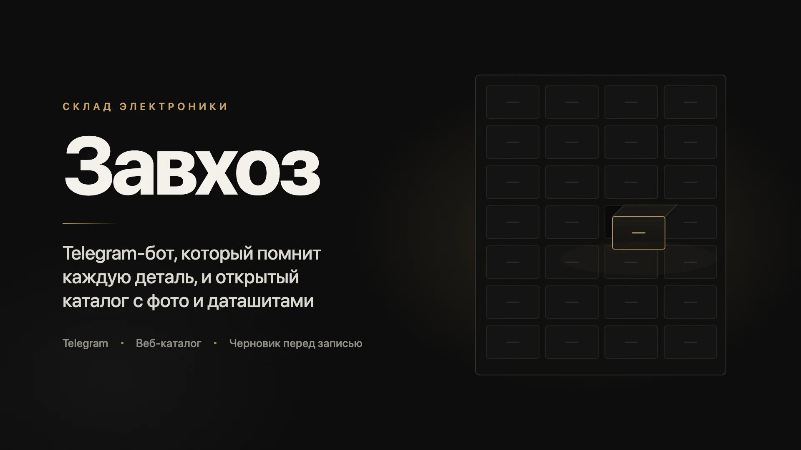
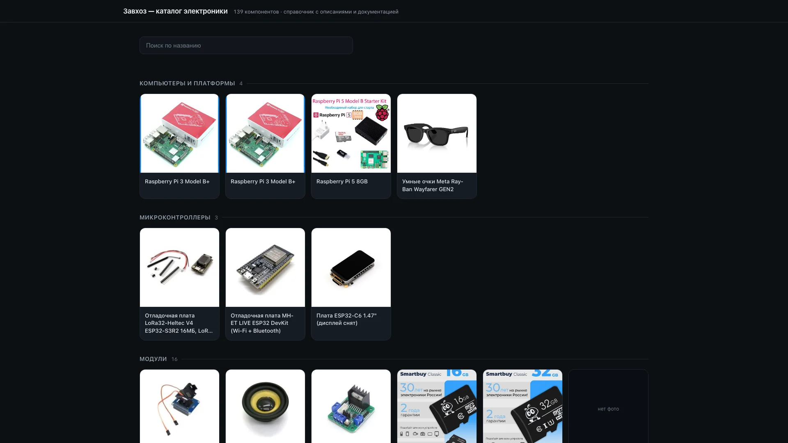

<div align="center">

# Завхоз

**Telegram-бот для личного склада электроники и открытый каталог деталей с фото, характеристиками и даташитами**



[Открыть каталог](https://azbezd.github.io/zavhoz-web/) · [Развернуть у себя](#установка) · [Эксплуатация](docs/deploy.md)

 

</div>

## Что это

Пишешь боту обычным языком — «купил два HC-SR04», «сгорел преобразователь», «провода» — или присылаешь фото, скриншот заказа, ссылку на товар. Бот разбирает сообщение и собирает черновик изменений; склад меняется только после нажатия «Применить». Каждая позиция получает фото, характеристики и ссылки на официальную документацию, а справочная часть склада публикуется как статический сайт-каталог.

## Как это выглядит



Публичный каталог — [azbezd.github.io/zavhoz-web](https://azbezd.github.io/zavhoz-web/). В нём только справочные данные: название, фото, характеристики, документация. Количество, цены, проекты и заметки остаются в приватной базе.

## Как пользоваться

| Пишешь боту | Что происходит |
|---|---|
| `купил 2 HC-SR04` | черновик «добавить 2 шт.» с кнопками «Применить» / «Отменить» |
| `сгорел преобразователь` | черновик списания существующей позиции |
| `провода` · `кондёры` · `PCA9685` | список подходящих позиций с количеством; каждая строка ведёт на карточку каталога |
| `есть чем мерить напряжение?` | поиск по смыслу: найдёт мультиметр, даже если слова «мультиметр» в вопросе нет |
| ссылка на amperkot.ru | черновик новой позиции с названием, ценой и фото со страницы магазина |
| фото детали или скриншот заказа | опознание и черновик по составу |
| `как подключить HC-SR04 к ESP32` | ответ как технический помощник |

Черновик можно поправить ответом на него («нет, их три») — бот пересоберёт. После применения позиция обогащается: описание, характеристики, ссылки на даташиты производителя.

Команды из меню: `/list` — склад по категориям, `/inv` — инвентаризация по одной позиции кнопками, `/edit` — точечная правка, `/projects` и `/newproject` — какие детали в каких проектах. Остальные: `/pending`, `/show`, `/apply`, `/discard` — работа с черновиками по номеру; `/enrich <id>` — заново обогатить позицию; `/export` — выгрузить базу в файлы; `/style <текст>` — запомнить, как с тобой разговаривать.

## Установка

Нужны Python 3.10+, токен Telegram-бота от [@BotFather](https://t.me/BotFather) и ключ OpenAI API. Сторонних пакетов нет — только стандартная библиотека.

```bash
git clone https://github.com/azbezd/zavhoz-bot.git
cd zavhoz-bot
cp inventory_bot/env.example .env   # впиши TELEGRAM_BOT_TOKEN, OPENAI_API_KEY, ALLOWED_TELEGRAM_USER_IDS
set -a && . ./.env && set +a
python3 -m inventory_bot.bot
```

База SQLite и папка для фото создаются сами при первом запуске.

`ALLOWED_TELEGRAM_USER_IDS` обязателен: пока он пуст, бот никому не отвечает — иначе любой, кто найдёт бота, тратил бы твой ключ OpenAI. Свой id видно в логе: напиши боту что угодно, в выводе появится строка `message … user_id=…`.

Каталог собирается одной командой — получится папка, готовая для GitHub Pages:

```bash
python3 -m inventory_bot.build_site site
```

Запуск как службы, все переменные окружения, прокси для OpenAI, выгрузка данных в отдельный репозиторий — в [docs/deploy.md](docs/deploy.md).

## Как устроено

Маршрутизация сообщений детерминированная: правила в `bot.py` сами решают, что перед ними — изменение склада, вопрос о наличии, ссылка, фото или разговор. OpenAI подключается только там, где нужен разбор естественного языка: черновик из свободной фразы, выбор позиций под вопрос, обогащение карточки и обычный разговор. Данные — SQLite (`storage.py`, схема в `schema.sql`); сайт генерирует `build_site.py` без шаблонизаторов и фреймворков.

## Лицензия

Лицензия пока не выбрана: код открыт для чтения, права у автора.

---

<div align="center">

Автор — [@azbezd](https://github.com/azbezd)

</div>
